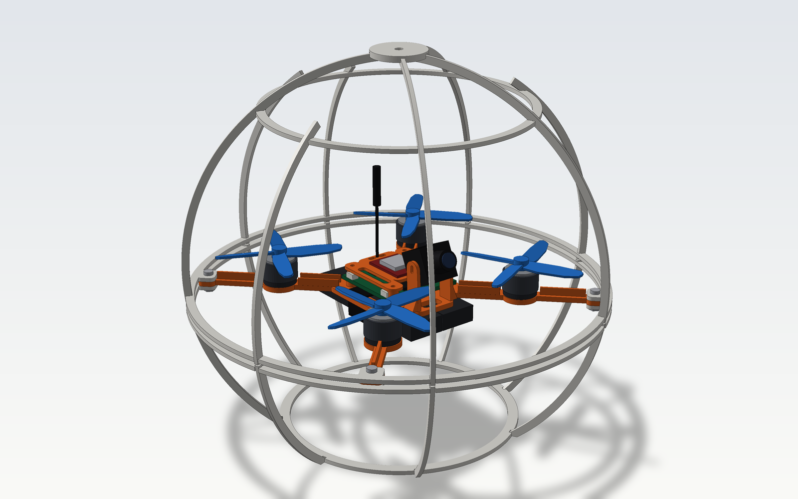
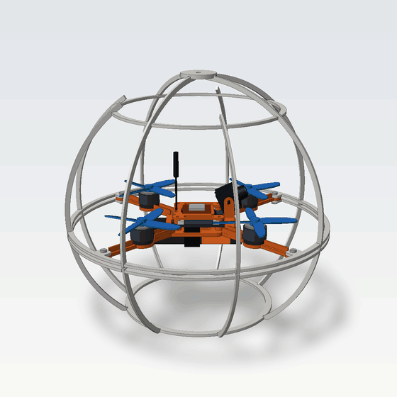
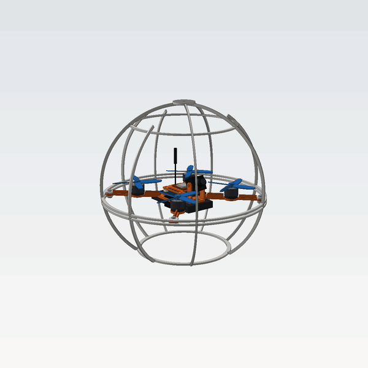
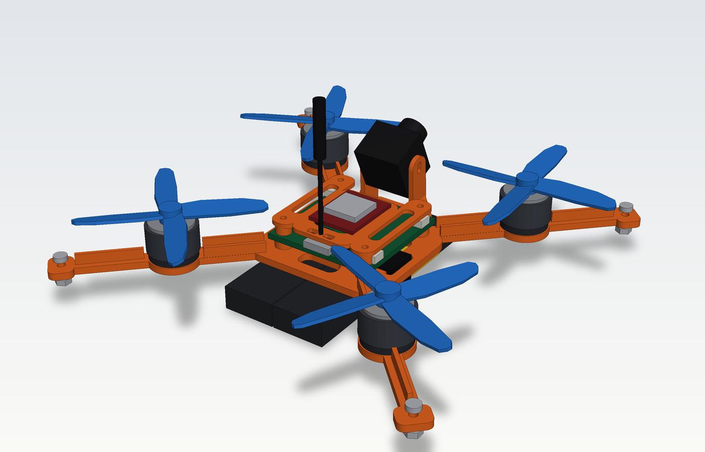
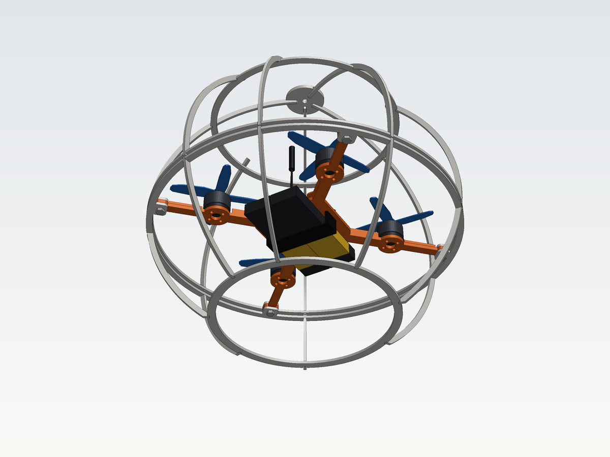
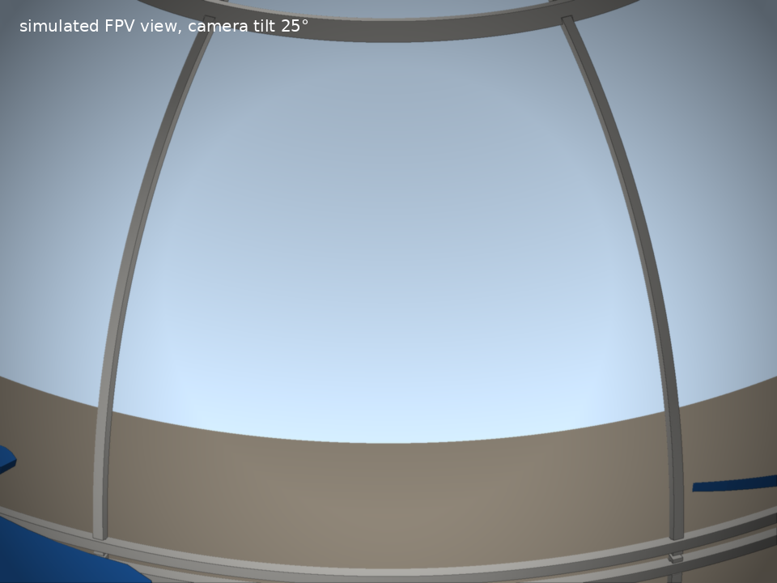
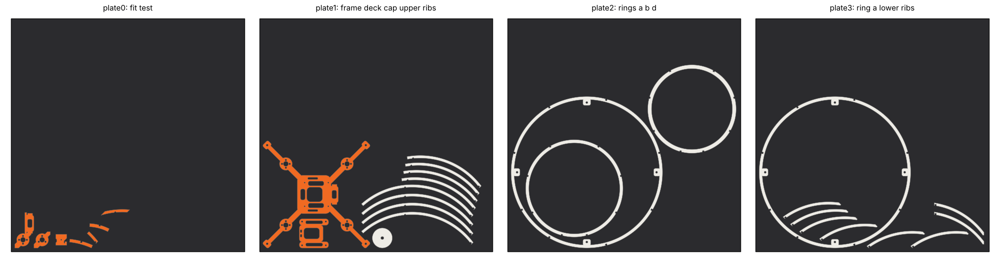

<div align="center">

<picture>
  <source media="(prefers-color-scheme: dark)" srcset="docs/readme/it/banner-dark.svg">
  
</picture>

<p>
  <a href="#stampa"><b>Stampalo</b></a> ·
  <a href="#come-è-fatto"><b>Come è fatto</b></a> ·
  <a href="#modificarlo"><b>Modificarlo</b></a> ·
  <a href="docs/build.md"><b>Guida al montaggio</b></a> ·
  <a href="README.md"><b>English</b></a>
</p>

</div>

**Cetus X ORB** è una gabbia a palla stampata per il **BetaFPV Cetus X**. Smonti il drone di serie, sposti motori, FC, camera e VTX su un telaio stampato e chiudi tutto dentro una sfera di 168 mm. Poi lo fai sbattere contro i muri apposta.



> [!NOTE]
> **Stato: v1, progettata e verificata al computer.** Non l'ho ancora stampata né fatta volare. Stampa per prima cosa il fit test e, se qualcosa non torna, apri una issue.

<picture>
  <source media="(prefers-color-scheme: dark)" srcset="docs/readme/it/features-dark.svg">
  
</picture>

## Perché

Il Cetus X è un bel whoop 2S, ma i duct proteggono le eliche solo di lato. Volevo qualcosa da far rimbalzare su soffitto, mobili e persone senza pensarci, e senza comprare un altro drone. Quindi riuso tutto quello che c'è nel Cetus X, e non si salda niente: i motori hanno lo spinotto, il resto si avvita.

<p align="center"></p>

## Numeri

| | |
|---|---|
| **Gabbia** | Sfera da 168 mm, alta 151 mm (il fondo è tagliato piatto per atterrare) |
| **Parti stampate** | 31 g di PETG: 23 pezzi più 2 di prova |
| **Peso al decollo** | Circa 89 g con 2× BT2.0 450 mAh 1S. Quello di serie fa circa 80 g |
| **Distanza minima tra un muro piatto e le eliche** | 7,7 mm, caso peggiore su 6000 direzioni |
| **Gioco statico eliche-gabbia** | 8,9 mm |
| **Motori, interasse** | 1103 11000KV di serie, 95 mm come il telaio originale |

Il peso è il numero da tenere d'occhio. Il Cetus X HD ha gli stessi motori e le stesse eliche e decolla a 92 g, quindi 89 g dovrebbero andare bene per un volo tranquillo. Freestyle no.

## Come è fatto

Tre pezzi tenuti insieme da 4 viti M2: la cupola alta, il telaio con l'elettronica e la cupola bassa. Le punte dei bracci restano strette tra le due cupole. Togli le 4 viti e le cupole si sfilano, anche con le eliche montate.

<p align="center"></p>

Ogni cupola è un incastro di pezzi piatti, come un separatore per uova: costole che vanno da polo a polo e qualche anello. Le fessure sono tutte orizzontali, quindi ogni costola entra da fuori e si aggancia a tutti i suoi anelli insieme. Una goccia di ciano per ogni incastro e hai finito. Visto che è tutto piatto non servono supporti, e una costola rotta si ristampa in cinque minuti.



Il telaio tiene la geometria originale, perché i cavi dei motori sono lunghi solo 32 mm. Ogni cavo passa in un canale lungo il braccio, la FC va sul solito 26 × 26 e la camera si inclina ancora da 0 a 40°. Le due batterie 1S stanno affiancate sotto il telaio con una cinghia velcro e si cambiano dal fondo aperto.



### Cosa vede la camera

Le due costole davanti sono a 60° l'una dall'altra, quindi il centro dell'immagine è libero. Ai lati vedi una costola, in alto e in basso gli anelli, un po' come i duct di un whoop normale. Questa è una vista simulata con la camera a 25°:



## Stampa

È tutto in `print/`. I piatti sono pensati per un piano 256 × 256 (io ho una Bambu P1P).

| File | Cosa c'è | PETG |
|---|---|---|
| `plate0_fit_test.3mf` | Pad motore a 4 e a 3 fori, torretta FC, culla camera, due campioni di incastro | 2,9 g |
| `plate1_frame_deck_cap_upper_ribs.3mf` | Telaio, deck VTX, mozzo polare, 8 costole alte | 15,5 g |
| `plate2_rings_a_b_d.3mf` | Anelli A, B, D | 8,7 g |
| `plate3_ring_a_lower_ribs.3mf` | Secondo anello A, 8 costole basse | 7,0 g |

**Impostazioni:** PETG, layer 0,2 mm, 4 pareti, riempimento 100% sul telaio, niente supporti. Per la gabbia ci vuole il PETG: si piega dove il PLA si spaccherebbe. I singoli STL sono in `print/stl/` e il numero dopo `_x` dice quante copie servono.



Impostazioni complete, fit test e montaggio passo passo sono in **[docs/build.md](docs/build.md)** (in inglese).

### Minuteria

Oltre ai pezzi stampati e al Cetus X:

- [ ] 4 viti M2×10 e 4 dadi M2 autobloccanti (chiusura cupole)
- [ ] 4 viti autofilettanti M1.4×10 (FC e deck). Se la tua FC ha fori da M2, vedi [Modificarlo](#modificarlo)
- [ ] Una cinghia velcro da 10 mm per la batteria
- [ ] Biadesivo spesso per il VTX
- [ ] Ciano liquido

## Modificarlo

Il modello è uno script Python, non un file CAD. Tutte le misure sono parametri nella classe `P` in cima a [src/orb.py](src/orb.py).

```
pip install -r requirements.txt
python3 src/orb.py                    # verifiche
python3 src/build.py                  # rigenera print/
python3 src/build.py --fit 0.16       # incastri più laschi
python3 src/build.py --fc-screw m2    # M2 invece di M1.4 per FC e deck
python3 src/render.py                 # rigenera le immagini
```

`orb.py` non si limita a disegnare i pezzi. Controlla anche che niente si compenetri, che la camera passi libera da 0 a 40°, che ogni costola entri davvero al suo posto, che le cupole si sfilino con le eliche montate e quanto può avvicinarsi un muro alle eliche. Fallo girare dopo ogni modifica. Se preferisci lavorare in Fusion o simili, `print/assembled_reference_DO_NOT_PRINT.3mf` contiene tutto il drone montato.

Le note di progetto, con il ragionamento e tutti i numeri, sono in [docs/design.md](docs/design.md).

## Cose ancora da verificare

- **Fori dei motori.** BetaFPV indica M1.6 su un cerchio da 8,5 mm, ma non dice se sono 3 o 4 fori. Il telaio di default ne ha 4, `frame_3_hole_motors_x1.stl` ne ha 3. Il fit test ti dice quale ti serve.
- **Viti della FC.** Sulle FC da whoop di solito sono M1.4, ma controlla la tua.
- **Viti laterali della camera.** La C04 è una nano da 14 mm; la culla ha un'asola che dà un po' di gioco in altezza.
- **Spinta.** Non ho dati di spinta veri per questi motori con queste eliche, solo il Cetus X HD come riferimento.
- **Auto-raddrizzamento.** Il baricentro sta 7 mm sotto il centro della palla, quindi su un pavimento liscio dovrebbe tornare dritto da solo. Magari no.

> [!WARNING]
> La gabbia non è una rete. Tutto quello che è più sottile delle maglie (circa 64 mm ai lati, 84 mm davanti), come un ramo o un palo, può comunque entrare.

## Licenza

Pezzi stampabili, immagini e documentazione sono [CC BY-SA 4.0](https://creativecommons.org/licenses/by-sa/4.0/deed.it). Il codice in `src/` è MIT. Vedi [LICENSE.md](LICENSE.md).

Non è un progetto BetaFPV e non ha legami con loro: il Cetus X è un loro prodotto, questo è solo un telaio. L'idea di un telaio da stampare per riusare un whoop di serie viene dalla conversione dell'Air65 di Hoarder Sam su MakerWorld.

---

<sub>Realizzato da <a href="https://github.com/gabrielevierti">Gabriele Vierti</a> a Milano.</sub>
