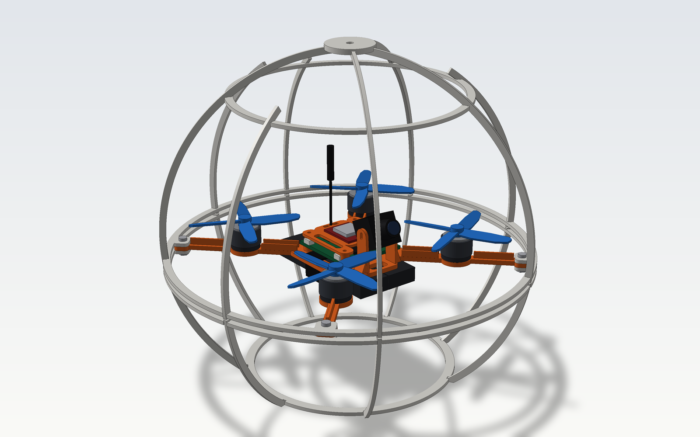
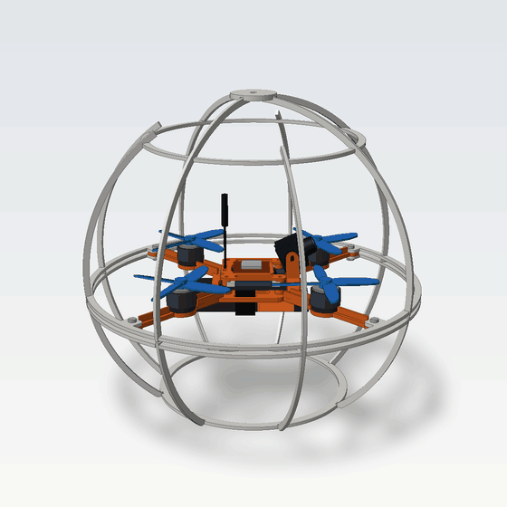
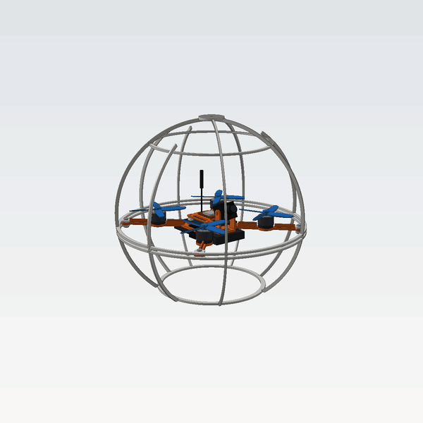
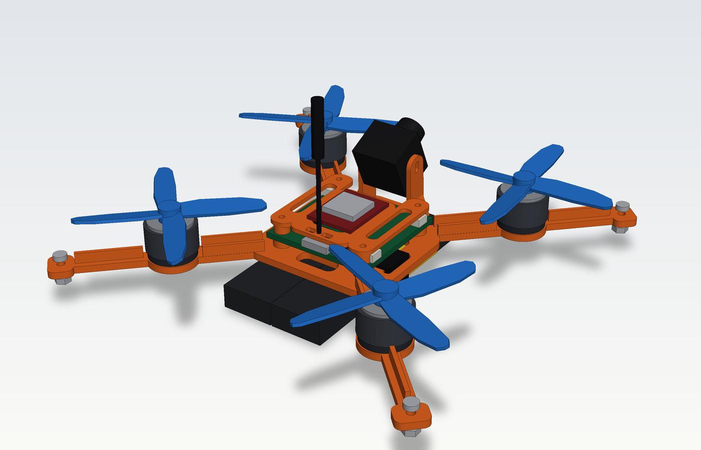
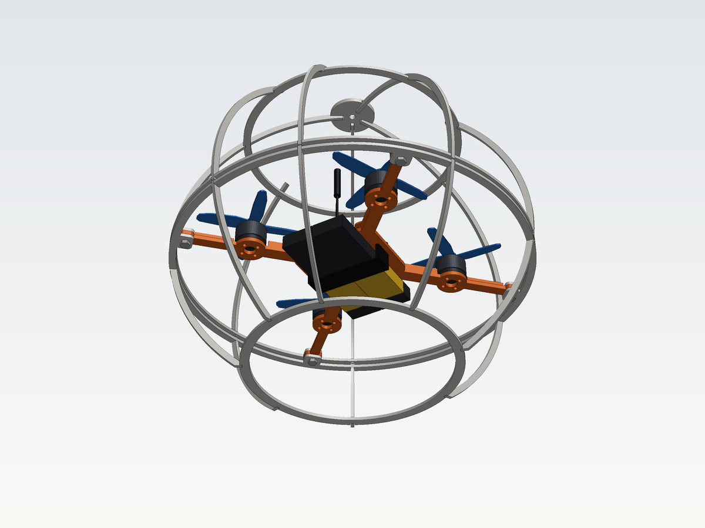
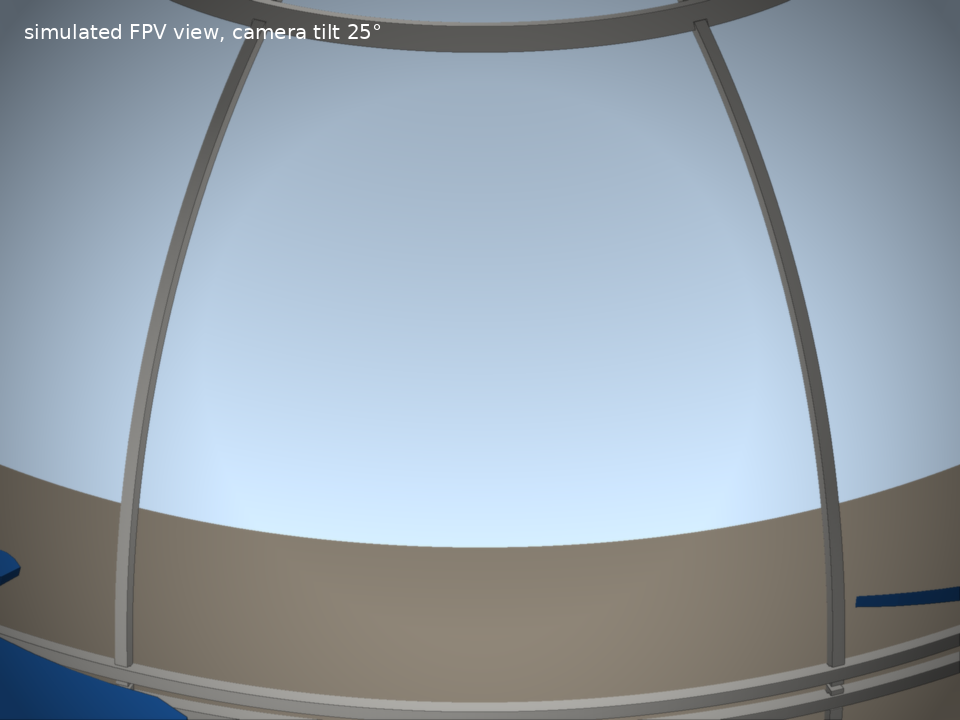
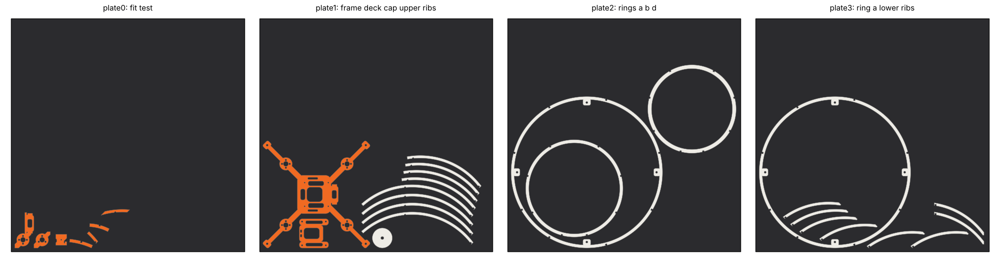

# Cetus X ORB

A printed ball cage for the BetaFPV Cetus X.

You take the stock quad apart, put the motors, flight controller, camera and VTX on a new printed frame, and close the whole thing inside a 168 mm sphere. Then you fly it into walls on purpose.



> **Status:** v1, designed and checked in software. I haven't printed or flown it yet. Print the fit test before anything else, and please open an issue if something doesn't fit.

[Leggi in italiano](README.it.md)

## Why

The Cetus X is a nice little 2S whoop, but the ducts only protect the props from the sides. I wanted something I could bounce off ceilings, furniture and people without thinking about it, and without buying another quad. So everything from the stock drone gets reused. No soldering: the motors plug into the FC, everything else is screws.

<p align="center"></p>

## Numbers

| | |
|---|---|
| Cage | 168 mm ball, 151 mm tall (the bottom is cut flat for landing) |
| Printed parts | 31 g of PETG, 23 parts + 2 fit-test pieces |
| All-up weight | about 89 g with 2× BT2.0 450 mAh 1S. The stock quad is about 80 g |
| Closest a flat wall can get to a prop | 7.7 mm, worst case out of 6000 directions |
| Static gap prop to cage | 8.9 mm |
| Motors, wheelbase | stock 1103 11000KV, 95 mm, same as the original frame |

The weight is the part I'd watch. The Cetus X HD uses the same motors and props and flies at 92 g, so 89 g should be fine for cruising. Don't expect freestyle.

## How it goes together

There are three pieces held together by four M2 screws: the top dome, the frame with all the electronics, and the bottom dome. The ends of the frame arms are clamped between the two domes. Take out the four screws and the domes lift off, props and all.

<p align="center"></p>

Each dome is an egg-crate of flat parts: ribs that run pole to pole, plus a few flat rings. Every slot is horizontal, so each rib slides in from the outside and hooks all of its rings at once. A drop of CA on every joint and it's done. Because everything is flat, nothing needs supports, and a broken rib is a 5 minute reprint.



The frame keeps the stock geometry because the motor leads are only 32 mm long. The motor leads run in a U channel along each arm, the FC sits on the usual 26×26 pattern, and the camera still tilts 0 to 40°. Two 1S packs sit side by side under the frame, held by a velcro strap, and you swap them through the open bottom.



## What the camera sees

The ribs in front are 60° apart, so the middle of the picture is clear. You'll see two ribs at the sides and the rings at the top and bottom edges, a bit like the ducts on a normal whoop. This is a simulated view at 25° tilt:



## Printing

Everything is in `print/`. The plates are laid out for a 256 × 256 bed (I use a Bambu P1P).

| File | What's on it | PETG |
|---|---|---|
| `plate0_fit_test.3mf` | motor pads (4 and 3 hole), FC post, camera cradle, two joint samples | 2.9 g |
| `plate1_frame_deck_cap_upper_ribs.3mf` | frame, VTX deck, pole cap, 8 upper ribs | 15.5 g |
| `plate2_rings_a_b_d.3mf` | rings A, B, D | 8.7 g |
| `plate3_ring_a_lower_ribs.3mf` | second ring A, 8 lower ribs | 7.0 g |

Use PETG, 0.2 mm layers, 4 walls, 100% infill on the frame, no supports. The cage really wants PETG: it bends where PLA would snap. Single STLs are in `print/stl/`, and the number after `_x` is how many you need.



Full settings, the fit test procedure and the step-by-step build are in [docs/build.md](docs/build.md).

## Hardware

Besides the printed parts and the stock Cetus X:

- 4× M2×10 screws and M2 nylon lock nuts (dome clamps)
- 4× M1.4×10 self-tapping screws (FC and deck). If your FC has M2 holes, see below
- a 10 mm velcro battery strap
- thick double-sided tape for the VTX
- thin CA glue

## Change it

The model is a Python script, not a CAD file. Every dimension is a parameter in the `P` class at the top of [src/orb.py](src/orb.py).

```
pip install -r requirements.txt
python3 src/orb.py                    # run the checks
python3 src/build.py                  # regenerate print/
python3 src/build.py --fit 0.16       # looser joints
python3 src/build.py --fc-screw m2    # M2 instead of M1.4 for FC and deck
python3 src/render.py                 # regenerate the images
```

`orb.py` doesn't just draw the parts. It also checks that nothing overlaps, that the camera clears everything from 0 to 40°, that every rib can actually slide into place, that the domes come off with the props mounted, and how close a wall can get to the props. Run it after you change anything. If you'd rather work in Fusion or similar, `print/assembled_reference_DO_NOT_PRINT.3mf` has the whole thing assembled.

The design notes, with the reasoning and all the numbers, are in [docs/design.md](docs/design.md).

## Things I'm not sure about yet

- **Motor holes.** BetaFPV lists the 1103 as M1.6 on an 8.5 mm circle but doesn't say whether that's 3 or 4 holes. The default frame has 4, and `frame_3_hole_motors_x1.stl` has 3. The fit test tells you which one you need.
- **FC screws.** Whoop boards are usually M1.4, but check yours.
- **Camera side screws.** The C04 is a 14 mm nano camera. The cradle has a slotted hole for some play in height.
- **Thrust.** I have no real thrust data for this motor and prop combo, only the Cetus X HD as a reference.
- **Self-righting.** The CG sits 7 mm below the centre of the ball, so it should roll back upright on a smooth floor. Might not.

The cage is not a net. Anything thinner than the gaps (about 64 mm at the sides, 84 mm in front) can still get in, like a branch or a pole.

## License

The printable parts, images and docs are [CC BY-SA 4.0](https://creativecommons.org/licenses/by-sa/4.0/). The code in `src/` is MIT. See [LICENSE.md](LICENSE.md).

Not affiliated with BetaFPV. Cetus X is their product, this is just a frame for it. The idea of a print-and-swap frame for a stock whoop came from Hoarder Sam's tiny Air65 conversion on MakerWorld.
