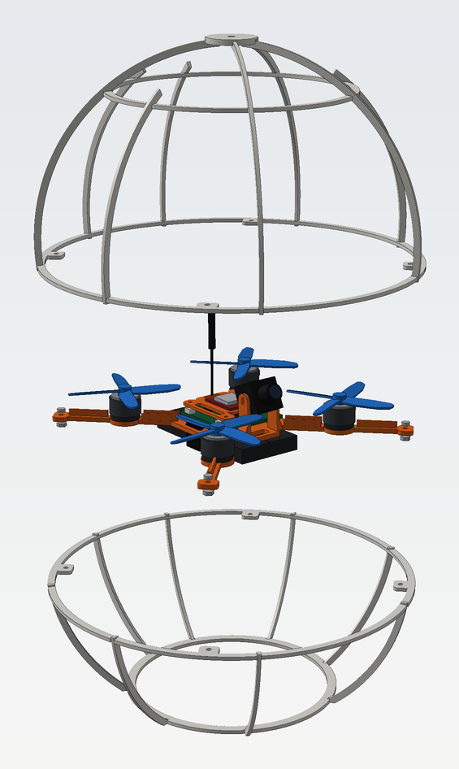

# Build guide

Plan on an evening. Most of the time goes into printing. The glue-up takes about half an hour.

## 1. Print the fit test first

`print/3mf/plate0_fit_test.3mf` takes a few minutes and saves you from reprinting the whole thing.

- **Motor pads.** One has 4 holes, the other 3. Put a motor on each and see which one lines up. If it's the 3-hole one, print `print/stl/frame_3_hole_motors_x1.stl` instead of the frame on plate 1.
- **FC post.** Drive an M1.4 screw into it. It should bite firmly without splitting the post. If your FC uses M2, run `python3 src/build.py --fc-screw m2` and use the new files.
- **Camera cradle.** The camera should sit between the cheeks with no side play, and its side screw hole should line up with the slot.
- **Joints.** There are two samples: a ring A segment with a rib stub, and a ring B segment with a rib stub. Each pair should push together by hand with a little pressure. If you need pliers, regenerate with `--fit 0.16`. If they rattle, use `--fit 0.08`.

## 2. Print settings

Bambu Studio, P1P, 0.4 nozzle. Anything similar should work.

| | |
|---|---|
| Material | PETG (Bambu generic profile) |
| Layer height | 0.20 mm. Ribs and rings are 8 layers, the frame is 10 |
| Walls | 4. Most parts end up solid anyway |
| Infill | 100% on the frame |
| Supports | none |
| Plate | textured PEI. On smooth PEI use glue stick, PETG sticks too well |
| Elephant foot compensation | 0.15 mm, keeps the slots clean |
| Brim | none. Add 3 mm on the lower ribs if they lift |

PLA+ is fine for the frame if that's what you have, but print the cage in PETG. TPU is too heavy and too floppy for this.

Print a couple of spare ribs of each type while you're at it.

## 3. Take the Cetus X apart

1. Pull the props with the prop tool. Mark each prop and each motor with its corner: front left, front right, rear left, rear right.
2. Remove the bottom cover and the canopy. Unplug the VTX, then unscrew the camera from its side screws.
3. Take a photo of the wiring. Unplug the four motors from the FC and unscrew the FC.
4. Unscrew the motors (4× M1.6 each). Keep every screw.

## 4. Frame

5. Mount each motor in the **same corner it came from**, using its own M1.6×4 screws from underneath. Lay the lead in the channel along the arm.
6. Put the FC on the four posts, arrow pointing at the camera cradle, and plug each motor back into **its own** connector.
7. Put the VTX deck on top of the FC and fit the four M1.4×10 screws through deck, FC and posts. Snug them, don't crank them. It's plastic.
8. Put the camera between the cheeks, set it to about 25° and tighten the side screws just enough to hold it.
9. Stick the VTX on the deck with foam tape. Zip-tie the antenna upright through the two slots at the back of the deck. Keep the receiver antenna away from the props too.
10. Thread the velcro strap through the two slots in the frame. Put the two packs side by side with the leads to the back, then plug in the stock series lead.
11. **With no props on**, connect to Betaflight. In the Motors tab, check that each motor spins and turns the right way. Then check the image in the goggles.

## 5. Domes (once, then they're glued)

The rings aren't symmetric. On rings A, B and D the **front is the widest gap between two slots** (60°) and the back is the narrowest (30°). Keep the fronts lined up with the camera.

12. **Top dome.** Lay a ring A flat on the table. The long ribs go in the two slots on either side of the front gap, and in the third slot from the front on each side. The short ribs go in the other four.
13. Slide one long rib in from the outside towards the centre until it seats. Hold ring B in that rib's notch and slide in the long rib on the opposite side. Ring B is now held. Slide in the other six ribs the same way, always horizontally, towards the centre.
14. Drop the pole cap onto the tips of the four long ribs, slots facing down.
15. Check that it's round and nothing wobbles, then put a drop of thin CA on every joint (15 of them).
16. **Bottom dome.** Same idea, upside down. Lay ring D on the table and hold ring A above it. Fit two opposite ribs first, then the other six, then glue.

## 6. Close it up

17. Set the frame on the bottom dome so the arm tips sit on the tabs and the wide gap is in front of the camera.
18. Put the top dome on and fit the four M2×10 screws from the top, with the lock nuts underneath.
19. Fit the props in their original places and spin each one by hand. Nothing should touch.

To get back in later, just take out the four screws. The top dome lifts straight up and the bottom one drops down, props included.

## 7. First flights

It's about 9 g heavier than stock and has more rotational inertia, because the cage mass sits far from the centre. Expect a higher hover throttle and a softer, lazier response, mostly in yaw.

- Both FC versions run Betaflight. For the Frsky D8 / Cetus FC version, BetaFPV ships BETAFPVF411RX 4.2.11 with their own CLI dump. Don't touch the ESC or motor settings.
- Start in Angle mode with low rates, on the stock tune.
- If it bounces or feels mushy when you stop, raise the PID master multiplier 0.1 at a time. If you get oscillation or hot motors, go back one step.

How I'd go about the first packs:

1. 30 s hover at knee height. Land and touch the motors: warm is fine, hot is not.
2. Slow bump into a sofa or a cushion.
3. Walking-speed bumps into a wall, then a ceiling touch.
4. After every pack, check the glue joints, the M2 screws and the prop tips for rub marks.
5. Outside only with little wind. A ball catches a lot more air than a whoop.

Land when the OSD shows around 3.5 V per cell under load. Expect a bit less than the stock 5 minutes.

## Fixing it

If a rib breaks, cut the glue at its joints with a hobby knife, slide it out sideways and slide a new one in. If a ring breaks, the whole dome is easier to reprint. It's under 9 g of plastic.
