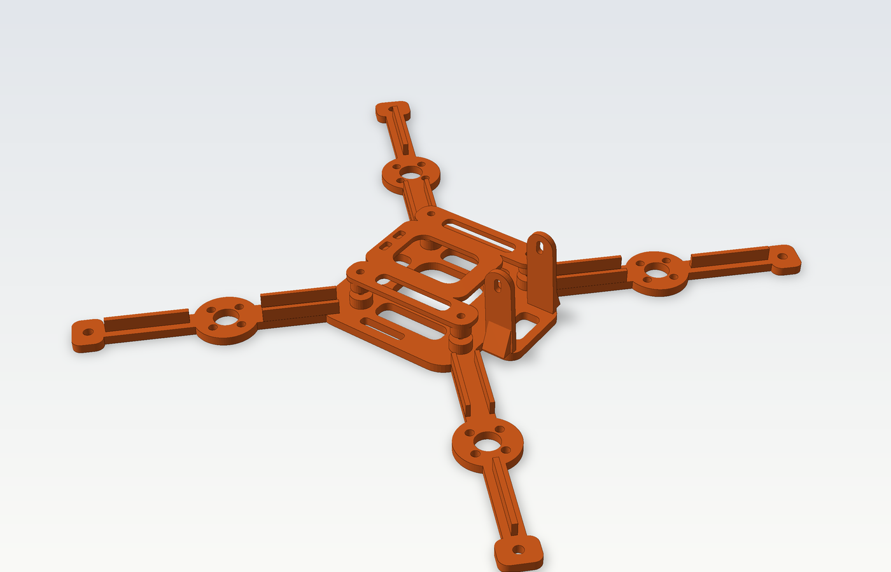
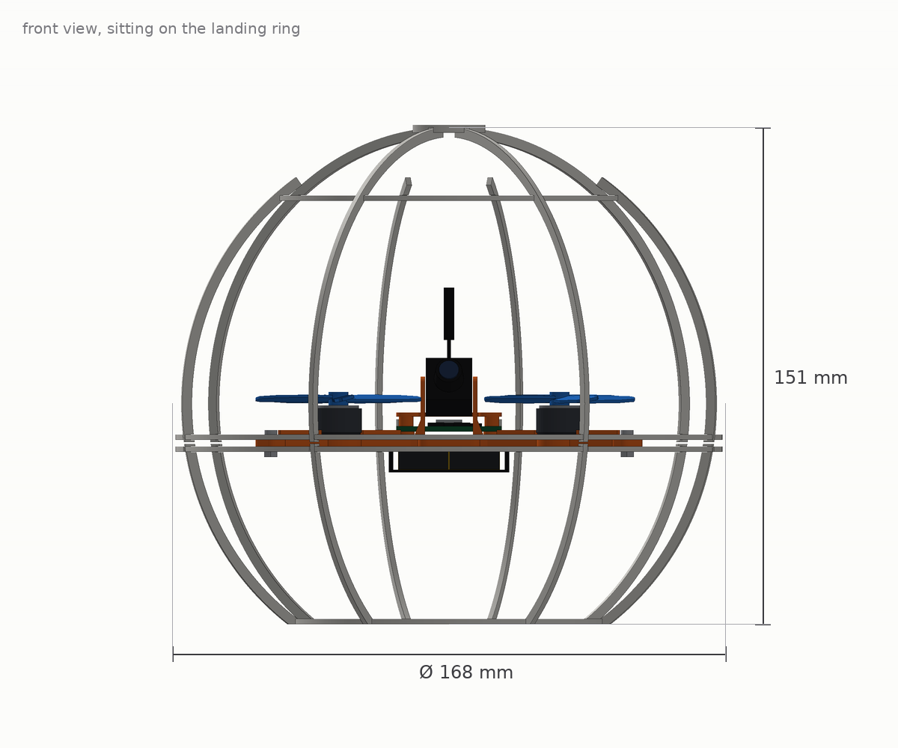

# Design notes

How the ORB ended up the way it is, and the numbers behind it. All numbers come from `python3 src/orb.py` (last output in [checks.txt](checks.txt)), which runs the checks on the actual geometry with stand-in blocks for the motors, props, FC, camera, VTX and batteries.

## What it had to do

1. Reuse the stock Cetus X electronics with no soldering.
2. Keep props, camera and electronics away from flat surfaces coming from any direction: walls, floor, ceiling, furniture.
3. Stay under the weight the motors can carry. The reference is the Cetus X HD, which flies at 92 g on the same 1103 11000KV motors and Gemfan 2020 props.
4. Print on a 256 mm bed without supports.
5. Make battery swaps quick, and make it fixable when something breaks.

## The stock hardware

These are the numbers the frame is built around, taken from BetaFPV's product pages.

| | |
|---|---|
| Wheelbase | 95 mm (stock frame: PA12, 24.2 g with canopy) |
| Motors | 1103 11000KV, M1.6 on Ø8.5, 14 mm tall, ~3.3 g, 32 mm leads with JST 1.25 plugs |
| Props | Gemfan 2020 4-blade, 50.3 mm disc, 4.5 mm hub, 0.93 g |
| FC | F4 2S 15A (Betaflight/ELRS) or Cetus BL V3 (Frsky D8), 26×26 whoop pattern |
| Camera + VTX | C04 module (Caddx Ant / RunCam Nano 4 base, 14 mm nano) + M04 VTX, 0–40° tilt |
| Battery | two BT2.0 450 mAh 1S in series, 62 × 15.5 × 6.7 mm, 12.7 g each |
| Quad without battery | 55 g |

The 32 mm motor leads decide a lot. They're why the wheelbase stays at 95 mm and the FC goes back where it was, in the same orientation.

## Frame

The frame is a flat X, 2 mm thick, printed face down.

- **Arms.** From the hub to the motor, each arm is a U channel: a 6 mm base with two 1 × 3 mm walls. That's much stiffer than a flat strip, and the motor lead lies inside it.
- **Motor pads.** 14 mm across and 2 mm thick, so the stock M1.6×4 screws go 2 mm into the motor. That's no deeper than on the stock frame, so they won't reach the windings.
- **FC posts.** 2.5 mm tall on 26×26, with 1.2 mm pilot holes for M1.4 self-tappers.
- **Camera cradle.** Two 1.4 mm cheeks with 14.5 mm between them, and the pivot at x = 19, z = 16. The pivot is a vertical slot with ±0.8 mm of play, because I don't know exactly where the C04's side holes are. The cheeks stay 2.2 mm clear of the front prop discs.
- **Battery tray.** Two slots for a 10 mm velcro strap. The packs sit 4 mm behind centre to balance the camera.
- **Arm extensions.** These run out to the clamp points, with an M2 hole at 76.5 mm from centre. They pass under the outer part of each prop, so they're narrow (4.5 mm) with a small rib on top.

The VTX deck is a separate plate held by the same four screws as the FC. The C04 has a short cable, so the VTX has to sit right behind the camera.

## Cage

### Shape

The sphere is 84 mm in radius. The props reach 72.65 mm from the centre, so that leaves room for the rib depth plus about 9 mm of air. I tried 82 mm first, but in the worst case a wall got within 5.4 mm of the props. 84 mm gets that to 7.7 mm for 0.7 g more plastic.

The centre of the ball is 11 mm above the frame plane. That keeps the props near the widest part of the sphere and puts the CG 7.3 mm below the centre, so the ball should want to sit upright. The bottom is cut flat at 52° south. The ring there is the landing gear and leaves a 88 mm hole for battery swaps.

### Ribs and rings

There are eight meridian ribs at ±30°, ±75°, ±120° and ±165°. The 60° gap in front is for the camera. The 30° gap at the back is where the extra rib ended up.

Each dome is built from flat parts:

- **Top dome:** ring A, four long ribs (±30°, ±120°) that run up to a small pole cap, four short ribs that stop just above ring B, ring B at 48° north, and the pole cap.
- **Bottom dome:** ring A, eight short ribs, and ring D, the landing ring at 52° south.

The two ring A's are the same part, printed twice. They clamp the arm tips between them with four M2 screws. Their tabs stay outside the prop discs, so either dome lifts off with the props mounted.

### Joints

Everything prints flat, so every rib is a flat arc and every ring is a flat washer. The trick is that **every slot is horizontal**. A rib slides in sideways towards the centre and catches all its rings at once. The script slides each rib in from 8 mm out and checks that it never runs into a ring on the way.

There are three kinds of joint:

- **Ring A, half-lap.** Near the equator a rib is almost vertical, so a plain half-lap works: the rib and the ring each give up half their depth, and each keeps 1.7 mm.
- **Rings B and D, notch.** Higher up or lower down the ribs lean over, and a horizontal half-lap would almost cut through them. So there the ring has the slots, and the rib only gets a 0.6 mm notch on its inner edge to set the ring's height. At its thinnest the rib still keeps 1.84 mm of its 3 mm.
- **Pole cap.** Blind slots that sit on the tips of the four long ribs, so it centres itself.

CA glue fills the joints. Once glued, every joint is effectively solid.

## Checks

| Check | Result |
|---|---|
| Flat wall pushed in from 6000 directions until it touches the cage: what's left to the props | **7.7 mm** (worst case, rear diagonal just above the equator) |
| Same, to motors / camera / batteries / FC / VTX | 26 / 44 / 38 / 56 / 65 mm |
| Static gap, props to cage | 8.9 mm |
| Static gap, props to frame (camera cheeks) | 2.15 mm |
| Camera swept 0–40° in 5° steps | clear of frame, FC, deck, VTX and props |
| Ribs sliding in from 8 mm out | no collision |
| Top dome lifted / bottom dome dropped with everything mounted | no collision |
| Overlaps between parts | none |
| Printed meshes | all watertight |

The wall test treats the cage as rigid. In a real crash it bends, and the 7.7 mm is what it can give before a prop tip touches. If a prop does tick a rib now and then, that's no worse than a whoop's prop hitting its duct.

## Weight

| | g |
|---|---|
| Frame | 7.9 |
| VTX deck | 1.0 |
| Ring A ×2 | 7.8 |
| Ring B | 2.3 |
| Ring D | 2.5 |
| Upper ribs (4 long, 4 short) | 5.5 |
| Lower ribs (8) | 3.1 |
| Pole cap | 1.0 |
| **Printed** | **31.2** |
| Stock electronics (55 g minus the 24.2 g stock frame) | 30.8 |
| Batteries | 25.4 |
| Screws, nuts, strap | 1.6 |
| **All-up** | **~89** |

The electronics figure is worked out from the stock weights, not weighed piece by piece. Weigh your own to be sure.

The cage started heavier, about 95 g all-up. These changes brought it down:

- Ribs from 3.4 to 3.0 mm deep, ring A from 3.8 × 1.8 to 3.4 × 1.6 mm.
- Only four of the upper ribs go all the way to the pole.
- One ring A design shared by both domes.
- More holes in the hub and deck.

## Thrust

I don't have a trustworthy thrust curve for 1103 11000KV on Gemfan 2020 at 2S. The Cetus X HD is the best reference I have: same motors, same props, 92 g, and BetaFPV sells it as a cinewhoop. At 89 g the ORB should fly like that, with a little extra loss from the ribs sitting in the airflow. If it turns out too heavy, there are two easy fixes. Use smaller packs, or go to six ribs per dome by editing `rib_az`.

## Things I'd look at for v2

- A removable grid to close the bottom.
- TPU bumpers over the ring A tabs.
- A printed jig to hold the rings while you glue the domes.
- A version for the Cetus X HD (BT3.0 2S, Walksnail).
- A wider camera window at the top.

## Sources

- [BetaFPV, Cetus X Brushless Quadcopter](https://betafpv.com/collections/all/products/cetus-x-brushless-quadcopter)
- [BetaFPV, Cetus X Brushless Whoop Frame](https://betafpv.com/collections/accessory/products/cetus-x-brushless-whoop-frame)
- [BetaFPV, 1103 Brushless Motors](https://betafpv.com/collections/bfcm2023/products/1103-brushless-motors)
- [BetaFPV, Gemfan 2020 4-Blade Propellers](https://betafpv.com/collections/products-excluding-o4-series/products/gemfan-2020-4-blade-propellers-1-5mm-shaft)
- [BetaFPV, BT2.0 450mAh 1S Battery](https://betafpv.com/collections/batt-1s/products/bt2-0-450mah-1s-30c-battery-4pcs)
- [BetaFPV, Cetus X HD FPV Kit](https://betafpv.com/products/cetus-x-hd-fpv-kit)
- [BetaFPV, F4 1S 12A AIO (26×26 pattern)](https://betafpv.com/collections/globo_basis_collection/products/f4-1s-12a-flight-controller)
- [Caddx Ant 14×14](https://www.getfpv.com/caddx-ant-1200tvl-1-8mm-fpv-nano-camera-14x14-black.html)
- [Cetus X manual: two 1S batteries](https://manuals.plus/asin/B0BF9ZY74L)
